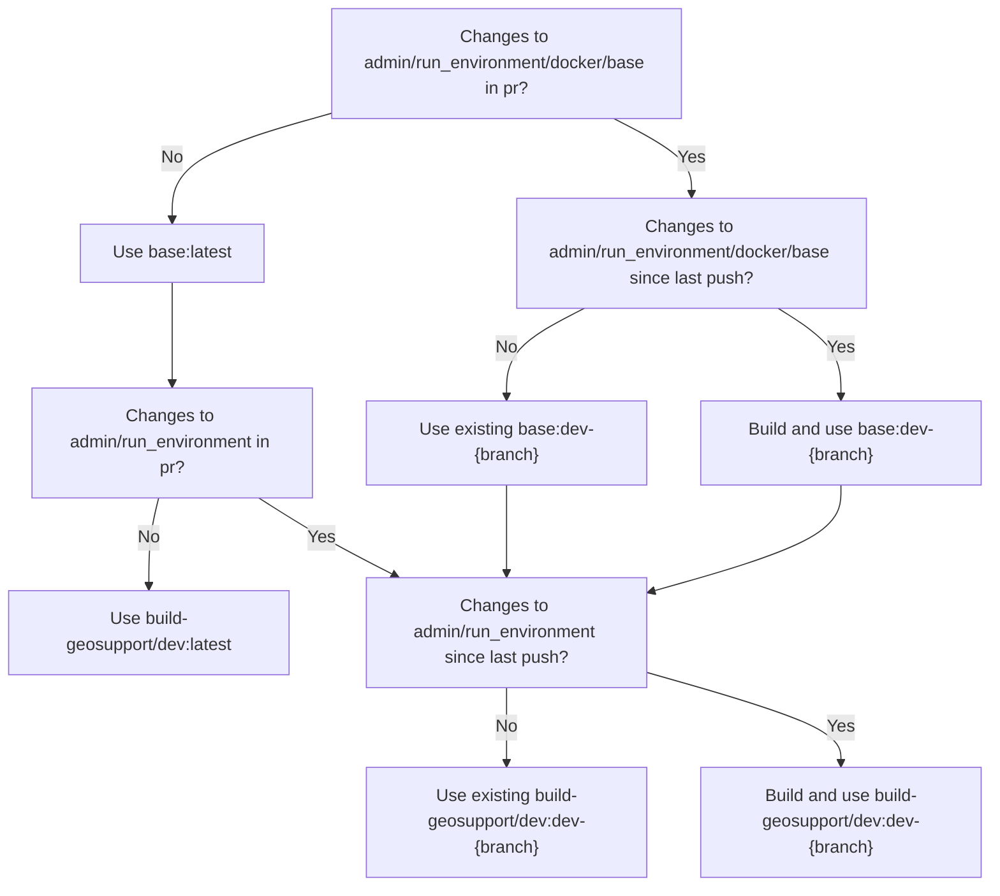

# Docker Images

We maintain 5 docker images, published to [Docker Hub](https://hub.docker.com/u/nycplanning) (along with some out-of-date images we no longer maintain).

**base** has python, our standard command line utilities, the postgres client, and GDAL compiled from source (`gdal_version` in `admin/run_environment/docker/base/setup.sh`).
GDAL is there for the `ogr2ogr` command line that product scripts call.
Python code reads and writes geospatial files through pyogrio, which ships its own GDAL.
Compiling GDAL takes a while, so base is its own image that rarely gets updated.

Three images build on base:

- **build-base**: the python dependencies of `dcpy-utils` and `dcpy-product-metadata`. `build-base-arm` is the same image built for arm.
- **build-geosupport**: geosupport, plus the python dependencies of `dcpy-lifecycle` with its `geo` extra
- **dev**: geosupport, plus the python dependencies of every workspace package, including dev tools like sqlfluff, ruff, and mypy. The [dev container](./development.md#dev-container) and CI tests run in it.

**docker-geosupport** is a bare image with python and geosupport.
It doesn't build on base, and we don't build dev tags of it.

## Code

Each image has a folder in `admin/run_environment/docker/` with some of:

- `Dockerfile`
- `setup.sh`, for install logic that would be clunky in the Dockerfile.
  Either one can use `config.sh`, which is copied into the build folder.
- `requirements.txt`, only in `docker-geosupport`.
  The other images get their python packages from the repo's `uv.lock`, exported at build time.

Also in `admin/run_environment/docker/`:

- `config.sh`: shared logic used by several images, like installing geosupport, and variables like `DEV_APT_PACKAGES`
- `geosupport_versions.py`: prints the latest geosupport version for use in bash scripts

In `admin/ops/`:

- `docker_build_and_publish.sh <image> <tag> [base_tag]` builds and publishes an image.
  `base_tag` only applies to images built on base.
  The script exports python requirements from `uv.lock`, copies `config.sh` into the image's folder, looks up the geosupport version if needed, then builds the image and pushes it to Docker Hub.
- `docker_delete.sh <image> <tag>` deletes a tag from Docker Hub.
  `clean_build_artifacts.py` calls it from the `stale_builds` workflow to clean out old dev tags.

To add something to the images, put it in `config.sh` and use it in the three images built on base, or put it in `base`.
`base` takes much longer to build, so `config.sh` is easier to iterate on.
GDAL (in `base`) and geosupport (in `config.sh`) are good examples of each.

We may simplify down to fewer images.
With dcpy growing, the build images keep getting bigger, and having lighter-weight images buys less than it used to.

## Dev tags

Dev tags are tags of our images built for a feature branch.
They aren't related to the dev container.

PR tests build them when the PR changes the relevant code:

The tests only rebuild an image when its code changed since the last push, and a new push cancels running tests.
So a push can look for a dev tag that was never built.
When that happens, close and reopen the PR to rerun all tests.
