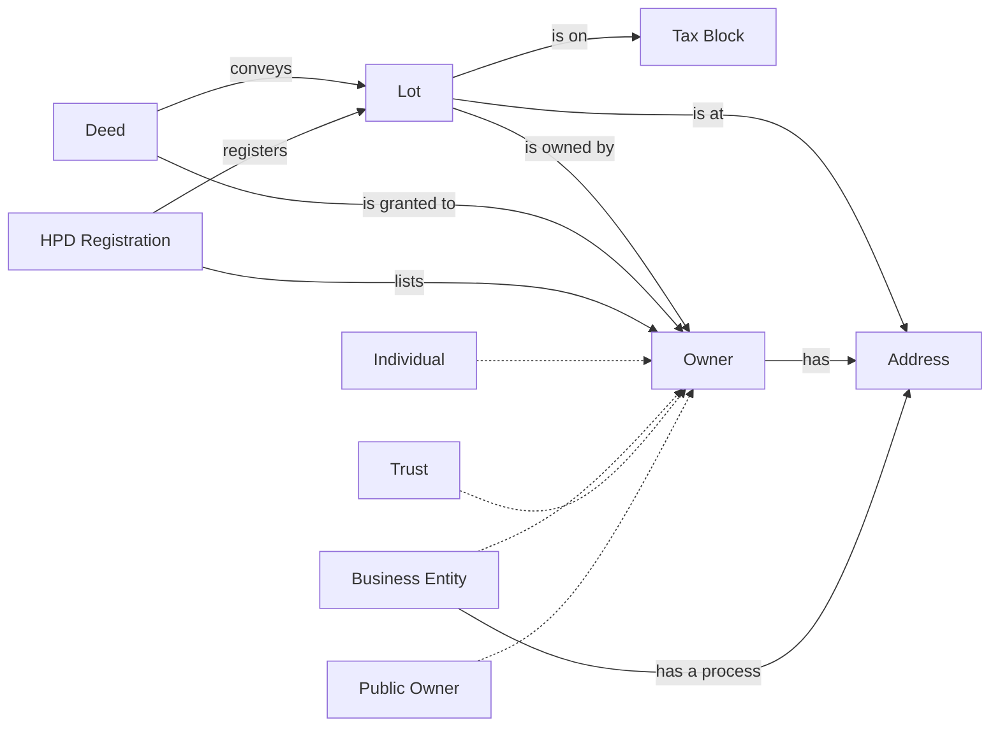
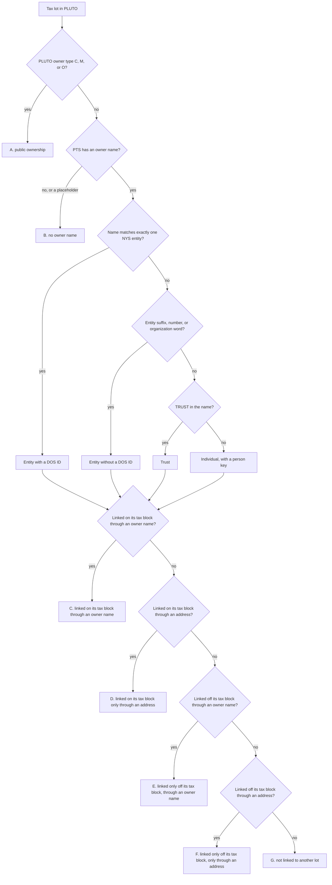

# Lot ownership

Exploring whether we can find lots with a common owner that PLUTO's owner names don't show, by linking tax lots to NY State business entities and deeds.
This is the exploration phase: one marimo notebook over source data in edm-recipes, with its own venv.
No dbt yet.

The goal is a table with at least `bbl`, the PTS owner name, the NYS entity name, and the entity's DOS ID, so downstream work can group lots by owner.

> [!NOTE]
> The notebook only reads ACRIS for the Bronx so far, so the deed steps and columns only cover Bronx lots, and the results are for the Bronx.

## Sources

The notebook reads each source from edm-recipes in place, at the versions in its `RECIPES`.

| Source | Version | Used for |
|---|---|---|
| `dcp_pluto` | 26v2 | one row per tax lot, with PTS's owner name and PLUTO's owner type |
| `pluto_pts` | 20261109 | not read by the notebook. Its only owner field is `av_owner`, the name PLUTO already carries, with no owner address |
| `hpd_registrations` ([HPD Multiple Dwelling Registrations](https://data.cityofnewyork.us/d/tesw-yqqr)) | 20261104 | registration to BBL and BIN |
| `hpd_registration_contacts` ([HPD Registration Contacts](https://data.cityofnewyork.us/d/feu5-w2e2)) | 20261104 | corporate owners, head officers, and agents behind each registration |
| `nysdos_active_corporations` ([NYS Active Corporations](https://data.ny.gov/d/n9v6-gdp6)) | 20261121 | DOS ID, entity name, process address, CEO, and registered agent. Dissolved entities aren't in it |
| `dof_acris_master`, `dof_acris_legals`, and `dof_acris_second_parties` ([ACRIS Real Property Master](https://data.cityofnewyork.us/d/bnx9-e6tj), [Legals](https://data.cityofnewyork.us/d/8h5j-fqxa), and [Parties](https://data.cityofnewyork.us/d/636b-3b5g)) | 20261110 | each lot's latest deeds and who they went to |
| `dof_acris_document_control_codes` ([ACRIS Document Control Codes](https://data.cityofnewyork.us/d/7isb-wh4c)) | 20260805 | not read by the notebook. What each document type is and what its parties mean, which `ACRIS_DEED_TYPES` is picked from |

`dof_acris_second_parties` is only party 2 of each document, which is the grantee on a deed.
The notebook takes deeds from Master by `ACRIS_DEED_TYPES` and the Bronx from Legals, since Master's `recorded_borough` is `1` for most recent documents wherever the lot is.

New York's LLC Transparency Act filings would name the people behind LLCs, but they aren't public.

## Data model

The main things the owner search works with and how they relate. Dotted edges are `is a`.
A Lot here is a row in PLUTO. That's a lot in the [urban planning glossary](../../../docs/glossary-urban-planning.md)'s sense, or a condo's billing lot, which PLUTO uses in place of the condo's base lot.



| Entity | Where it comes from |
|---|---|
| Lot | PLUTO, one row per BBL, including condo billing lots |
| Tax Block | the first six digits of a BBL. It isn't always one physical block |
| Owner | PTS names one per lot. A deed can name several |
| Business Entity | NYS Active Corporations, identified by DOS ID |
| Deed | ACRIS Master and Legals |
| HPD Registration | HPD Multiple Dwelling Registrations and Registration Contacts |
| Address | a lot's own address in PLUTO, grantee addresses in ACRIS Parties, and process addresses in NYS Active Corporations |

## Owner search

The notebook does this for every tax lot in PLUTO.
Each lot follows one path through the tree below, which ends in the groups in [Results](#results).
How lots get linked is in [Links](#links), and the numbered steps after that spell out each part.



### Links

Two lots are linked when they share one of these and it counts for both lots.

| Link | Lots that share it | It counts unless |
|---|---|---|
| DOS ID | lots whose owner names matched the same NYS entity | always counts |
| owner name | individuals with the same person key, or entities and trusts without a DOS ID with the same name | always counts |
| grantee address (Bronx) | lots whose latest deeds went to someone at the same address | a government is a grantee there, more than 10 lot owners use it, or the lot is owned by an individual whose name shares no word with another owner there |
| NYS process address | lots whose entity uses it, and entity-owned lots at that address | more than 10 lot owners use it |

The individual rule leaves out buyers who lived at an address, often an apartment building, owned or rented by someone unrelated.
It keeps family members and the same person written two ways, like `MONTES, MANUEL` and `MANUEL J MONTES`.
Name words leave out words many unrelated owners share, like `LLC`, `REALTY`, or `BRONX`.
It also drops some real links, like `YONGCHANG REALTY LLC` and `LIN, YONG ZHEN`, since `YONGCHANG` and `YONG` aren't the same word.

### Classify the owner

1. If PLUTO's owner type is C, M, or O (from COLP), flag the lot `has_public_ownership` and stop.
   Owner type X only means fully tax exempt, which includes private institutions, so those lots go on with `is_fully_tax_exempt` set.
2. If PTS has no owner name, or a placeholder (`UNAVAILABLE OWNER`, `NAME NOT ON FILE`, `UNKNOWN`), flag the lot `has_no_owner_name` and stop.
   Most condo billing lots end here.
3. Normalize the PTS owner name: uppercase, drop punctuation, and spell entity suffixes one way (`L.L.C.` and `LIMITED LIABILITY COMPANY` become `LLC`).
   Names are compared with spaces removed, since PTS splits some long names with a stray space (`CORPORATI ON`).
4. Look the name up in NYS Active Corporations, and keep the DOS ID only if exactly one entity has that name.
   If no entity does, and the name has no comma and has a number or a business word like `REALTY` or `HOLDINGS`, look it up again without entity suffixes, so `245 PD REALTY` finds `245 PD REALTY LLC`.
5. Flag the owner as one of:
   - `is_owned_by_an_entity` if the name ends in an entity suffix, matched a NYS entity, or has no comma and has a number or an organization word (the business words, plus words like `UNIVERSITY`, `CHURCH`, or `HDFC`)
   - `is_owned_by_a_trust` if the name has `TRUST` in it
   - `is_owned_by_an_individual` otherwise
6. For an individual, make a person key by turning `LAST, FIRST` into `FIRST LAST`, since PTS writes names both ways.
   Titles and generational suffixes are dropped, so `MR. & MRS. JAMES MARTIN` and `MARTIN, JAMES JR` both become `JAMES MARTIN`.

### Check the latest deed

7. Find the lot's latest deeds in ACRIS and check whether the PTS owner is one of the grantees.
   Every deed dated on the latest date counts, since one sale can be recorded as several deeds.

### Link lots

8. Link lots that share any of:
   - a DOS ID
   - a normalized owner name: the person key for individuals, or the name for entities and trusts without a DOS ID
   - a grantee address on their latest deeds
   - a NYS process address, either the owning entity's process address or the lot's own address when an entity owns the lot
9. Count each lot's linked lots, citywide and on its own tax block, using only links that count (see [Links](#links)).
   Only lot owners count toward the limit of 10 per address, so a building full of law offices that own no lots doesn't hide one owner's office in it.

Linked lots aren't grouped into owners yet.
HPD head officers are measured but not used as a link, since they include co-op board members and property managers.

## Results

From the notebook's Summary section, with the source versions above.
Every Bronx lot is in exactly one group, checked top to bottom.
A link through an owner name is one PLUTO already shows. A link through an address is one it doesn't.

| Group | Lots | % |
|---|---|---|
| A. public ownership | 2,039 | 2.3 |
| B. no owner name | 483 | 0.5 |
| C. linked on its tax block through an owner name | 10,149 | 11.4 |
| D. linked on its tax block only through an address | 2,634 | 2.9 |
| E. linked only off its tax block, through an owner name | 12,613 | 14.1 |
| F. linked only off its tax block, only through an address | 8,613 | 9.6 |
| G. not linked to another lot | 52,831 | 59.1 |
| total | 89,362 | 100.0 |

The same Bronx lots by kind of link. These overlap, since a lot can have several kinds.

| Link | Lots linked | % of Bronx lots | Lots linked on their tax block | % |
|---|---|---|---|---|
| `latest_deed_grantee_address` | 19,314 | 21.6 | 9,532 | 10.7 |
| `pts_person_name` | 14,455 | 16.2 | 4,368 | 4.9 |
| `nys_process_address` | 9,558 | 10.7 | 3,905 | 4.4 |
| `dos_id` | 6,175 | 6.9 | 4,340 | 4.9 |
| `pts_entity_name` | 2,510 | 2.8 | 1,474 | 1.6 |

Groups E and F are the least reliable.
Person names are linked citywide, so group E includes different people with common names.
Group F was 18,075 lots before the individual rule in [Links](#links), mostly buyers who once lived at the same apartment building.
The links between two entities still in it look mostly real, like `4202 ONEIDA AVENUE, LLC` and `809 CLARENCE AVENUE, LLC`, which share a grantee and a process address.
How often a link means the same owner hasn't been measured yet (see [Labels](#labels)).

## Tables

The notebook builds these in DuckDB. Normalized names and addresses end in `_key`.

| Table | Grain | From |
|---|---|---|
| `lot` | tax lot (`bbl`) | PLUTO, joined to everything below |
| `lot_link` | lot x link type x link key, one row per thing a lot shares with other lots | `lot`, `acris_latest_deed_grantee`, `grantee_address`, `grantee_address_named_individual`, `process_address_lot`, `process_address` |
| `grantee_address` | normalized grantee address on Bronx latest deeds, with how many lots and owner names use it | `acris_latest_deed_grantee`, `lot` |
| `grantee_address_named_individual` | grantee address x lot owned by an individual that shares a name word with another owner there | `acris_latest_deed_grantee`, `lot` |
| `process_address_lot` | lot x NYS process address it's linked to | `lot`, `nys_entity` |
| `process_address` | normalized NYS process address, with how many lot owners and NYS entities use it | `process_address_lot`, `nys_process_address` |
| `nys_entity` | NYS entity (`dos_id`) | NYS Active Corporations |
| `nys_process_address` | normalized process address, with how many NYS entities use it | `nys_entity` |
| `hpd_registration` | HPD registration (`registration_id`) | HPD Multiple Dwelling Registrations |
| `hpd_contact` | contact on a registration | HPD Registration Contacts |
| `acris_latest_deed_grantee` | Bronx lot x latest deed x grantee | ACRIS |

### `lot`

Every lot gets exactly one owner flag.
`is_fully_tax_exempt` and `is_condo_billing_lot` describe the lot, not the owner, so they're set alongside an owner flag.
A null in a later column is explained by the flags: `dos_id` is null for a lot owned by an individual, and the deed columns are null outside the Bronx.

| Column | What it is |
|---|---|
| `bbl` | borough, block, and lot |
| `borough_block` | the first six digits of `bbl`, the tax block |
| `ownername` | the owner name from PTS, through PLUTO |
| `owner_key` | `ownername` normalized. Null for placeholder names |
| `owner_person_key` | `ownername` normalized, with `LAST, FIRST` turned into `FIRST LAST` and titles dropped. Null for placeholder names |
| `owner_match_key`, `owner_bare_key` | `ownername` normalized with spaces removed, and the same without an entity suffix |
| `has_public_ownership` | owner flag: PLUTO owner type C, M, or O |
| `is_owned_by_an_entity` | owner flag: see step 5 of the owner search |
| `is_owned_by_a_trust` | owner flag: the name has `TRUST` in it and isn't an entity |
| `is_owned_by_an_individual` | owner flag: any other private owner name |
| `has_no_owner_name` | owner flag: no owner name in PTS, or a placeholder |
| `is_fully_tax_exempt` | PLUTO owner type X, which can be public or a private institution |
| `is_condo_billing_lot` | PLUTO has a condo number for the lot. Its owner name is a placeholder, the sponsor, or the board, not the unit owners |
| `has_one_nys_entity`, `has_several_nys_entities` | how many NYS entities have the normalized owner name |
| `nys_match_method` | `exact`, or `without suffix` when the name only matched after dropping entity suffixes |
| `nys_entity_name`, `dos_id` | the NYS entity, when exactly one matches |
| `process_address_nys_entities` | how many NYS entities share the matched entity's process address |
| `has_hpd_registration` | HPD has a registration for the lot |
| `has_acris_coverage` | the lot is in the Bronx, the only borough the notebook reads ACRIS for |
| `latest_deed_date`, `latest_deed_grantees` | the date of the lot's latest deeds, and how many grantees they name |
| `is_pts_owner_a_latest_grantee` | whether the PTS owner is one of those grantees. Null when there's no deed to compare |
| `linked_lots` | how many other lots share a counted link in `lot_link` with this one. Person name links make this noisy citywide |
| `linked_lots_on_block` | the same, counting only lots on this lot's tax block |
| `is_linked_by_owner_name`, `is_linked_by_owner_name_on_block` | the lot shares a counted DOS ID or owner name link with another lot, anywhere or on its tax block |
| `is_linked_by_address`, `is_linked_by_address_on_block` | the same, for grantee and NYS process address links |

### `lot_link`

| `link_type` | `link_key` | Lots |
|---|---|---|
| `dos_id` | the DOS ID | lots with one NYS entity |
| `pts_entity_name` | `owner_match_key` | lots owned by an entity or trust with no DOS ID |
| `pts_person_name` | `owner_person_key` | lots owned by an individual |
| `latest_deed_grantee_address` | a grantee's normalized house number and street | Bronx lots with a grantee address |
| `nys_process_address` | a NYS process address, normalized the same way | lots whose entity uses it, and entity-owned lots at it |

`is_counted` is false for links that don't count (see [Links](#links)).
`address_owner_names` says how many lot owners use the address, and `address_nys_entities` how many NYS entities do.

Being on the same tax block is something to filter or count on (`borough_block`, `linked_lots_on_block`), not a rule.
Common ownership can span blocks, and neighbors can share a name by chance.
Tax blocks stand in for nearness until there's adjacency from lot geometry.

## Labels

`labels/link_sample.csv` is a fixed sample of 100 pairs of lots that share a link, for measuring how often each kind of link means the same owner.
Labeling is on hold for now.
The notebook writes the file once and never overwrites it.
Fill in `is_same_owner` with `yes`, `no`, or `unsure`, and the notebook scores each kind of link.

## Running it

From this folder, with direnv loading the repo's root `.env` for S3 credentials:

```bash
uv venv --python 3.13
uv pip install --python .venv/bin/python --requirement requirements.txt

marimo edit notebooks/explore_ownership.py
```

To change dependencies, edit `requirements.in` and run `uv pip compile requirements.in -o requirements.txt --python-version 3.13`.
