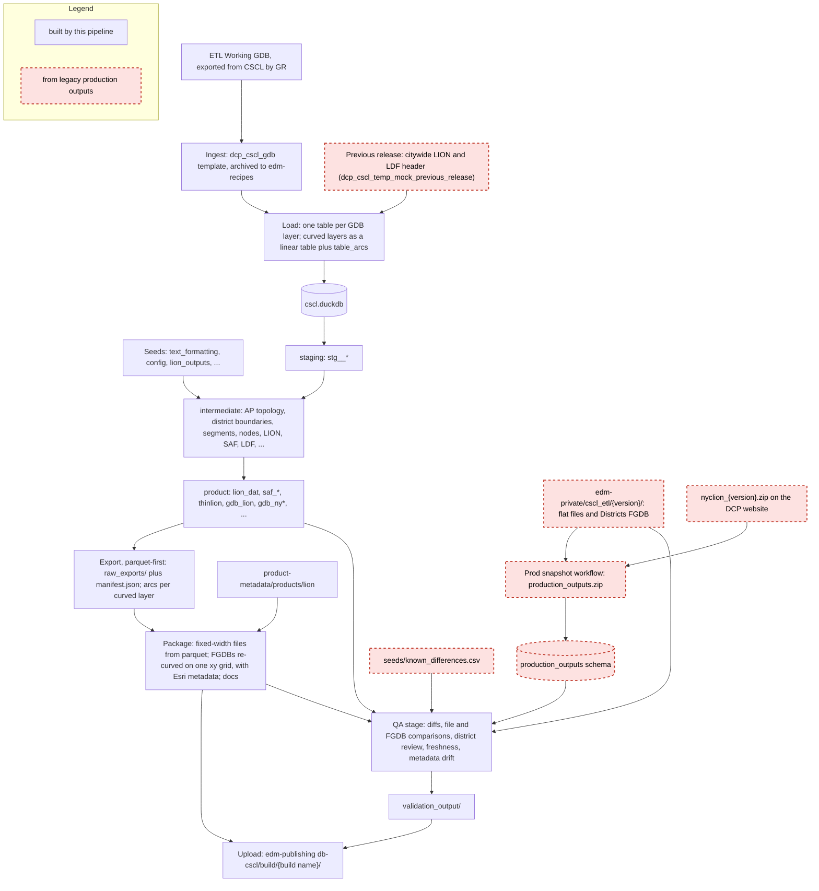
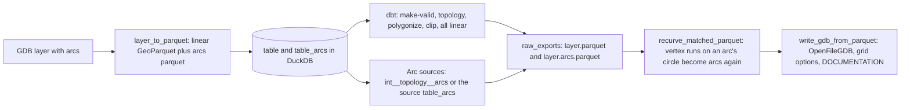
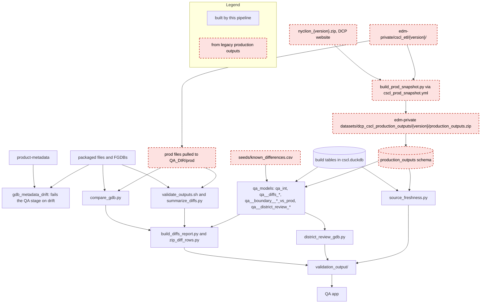

# CSCL Build Architecture

How the CSCL build turns one ETL Working GDB into the LION flat files, the SAF and other
Geosupport files, and the LION and district geodatabases, and how QA checks the result
against the legacy pipeline. Written for a developer new to CSCL; the
[README](../README.md) is the runbook and [design_doc.md](../design_doc.md) has the output
specs.

Everything runs as `dcpy lifecycle builds` stages, in the order
[`cscl_build.yml`](../../../.github/workflows/cscl_build.yml) calls them: plan, load,
build, export, package, QA, upload. The transforms are a dbt project on DuckDB
(`cscl.duckdb`, from `duckdb_filename` in [`recipe.yml`](../recipe.yml)).

## The whole process

Shapes outlined in red with a dashed border come from the legacy pipeline's production
outputs (GR's releases). Everything else is built here.

The legacy pipeline enters the build in two places:

- **QA** compares every output against the legacy release of the same version, through the
  prod snapshot (the `production_outputs` schema) and the raw prod files.
- **The LDF build** reads the previous release's citywide LION and LDF header from GR's
  outputs (`previous_citywide_lion`, `previous_ldf_header`), since the LDF documents the
  change between two releases. These are pinned CSVs; see the README's
  [LDF section](../README.md#release-inputs).

Nothing else on the build path reads a legacy output.

## Curved geometry: load to package

CSCL stores true circular arcs. DuckDB has no curve types, and its `ST_Read` linearizes
curves silently, so curved layers take a separate path: split into linear geometry plus a
table of arcs at load, plain linear SQL in dbt, re-curved at packaging.

- **Load** ([`data_loader.py`](../../../python/lifecycle/dcpy/lifecycle/data_loader.py)):
  a recipe input with `load_engine: curves` goes through
  `dcpy.geospatial.curves.layer.layer_to_parquet`, which writes the layer's linear
  geometry as GeoParquet and every arc's control points (`x0, y0, x1, y1, x2, y2`, with
  the part, ring and vertex range each one replaces) to `<table>_arcs`. Other layers load
  with `ST_Read`, and a curved layer that `ST_Read` rejects falls back to the curve path. The linearizer
  (`dcpy.geospatial.curves.linearize`) is ours, so linearization is the same everywhere
  it runs, including on prod's FGDBs in the snapshot.
- **Zero-length arcs**: GDAL's OpenFileGDB driver decodes some zero-length FGDB arcs as
  full circles. `dcpy.geospatial.curves.wkb` detects and drops them at load (see
  `_is_misread_point_arc`); otherwise a segment would come out as a giant circle.
- **dbt** sees only linear geometry. The topology keeps the arcs it traced:
  `int__topology__arcs` holds one row of control points per arc edge.
- **Export** writes each FGDB layer as `raw_exports/<group>/<file>/<layer>.parquet` and,
  for layers whose recipe entry names `custom.arcs`, the arcs it's re-curved from as
  `<layer>.arcs.parquet`.
- **Package** ([`builds/export.py`](../../../python/lifecycle/dcpy/lifecycle/builds/export.py),
  `package`) re-curves with `dcpy.geospatial.curves.match.recurve_matched_parquet`. SQL
  moves vertices away from arc indices (make-valid, polygonize, clip), so it matches by
  geometry rather than by index: a run of consecutive vertices that lies on one arc's
  circle, inside its sweep and within the linearization tolerance, becomes that arc again
  (or the piece of it a node split off). The curved WKB then goes into the FGDB as-is.

Which arcs each layer is re-curved from (`custom.arcs` in `recipe.yml`):

| Layers | Arcs |
|---|---|
| `lion` | the centerline, shoreline, rail, subway and non-street-feature source arcs |
| 37 topology-built district layers | `int__topology__arcs` |
| `nypp` | `int__topology__arcs` and `dcp_cscl_nypdprecinct_arcs` |
| `nyap`, `nybid` | their source arcs (pass-through layers) |
| `nyhd`, `nyura`, `nyzip` | none: no curves in prod |
| `node` | none: points |

## Stages

### Plan and load

- **What**: `builds plan` resolves the recipe into `recipe.lock.yml` (input versions; the
  prod snapshot takes the build's own version through `version_env_var: VERSION`).
  `builds load` downloads each input and loads it into `cscl.duckdb`.
- **Inputs**: 57 layers of `dcp_cscl_gdb` (the ETL Working GDB, archived by
  [`ingest_templates/dcp_cscl_gdb.yml`](../../../ingest_templates/dcp_cscl_gdb.yml)),
  the two previous-release CSVs, and `dcp_cscl_production_outputs` (file type
  `parquet_bundle`: each parquet in the zip becomes a table in schema
  `production_outputs`).
- **CI guard**: the "Check prod snapshot" step in `cscl_build.yml` fails right after
  planning if the snapshot for the build's version doesn't exist, and says how to make it.

### Build (dbt)

`builds build` runs the recipe's `stage_config` `builds.build` commands: `dbt deps`,
`dbt seed`, `dbt run` and `dbt test` with the `duckdb_build` selector
([`selectors.yml`](../selectors.yml)), which is everything except the QA models
(`models/qa_int`, `models/etl_dev_qa`).

| Layer | Path | Key models |
|---|---|---|
| staging | `models/staging/` | `stg__atomicpolygons`, `segments/stg__centerline`, `stg__nodes`, one per district source |
| intermediate | `models/intermediate/` | `atomicpolygon_topology/int__topology__*`, `district_boundaries/int__boundary__*`, `segments/int__primary_segments`, `int__lion`, `saf/`, `ldf/`, `snd_and_normalizing_tables/` |
| product | `models/product/` | `lion/lion_dat`, `lion/gdb/gdb_lion`, `districts/gdb_ny*`, `saf/`, `thinlion/`, `ldf/`, ... |
| logs | `models/log_files/` | `log` (the `log.csv` export) |

DuckDB stand-ins for the PostGIS functions the models call are macros in
[`macros/duckdb_functions.sql`](../macros/duckdb_functions.sql); see
[duckdb_porting_guide.md](./duckdb_porting_guide.md).

**District boundaries come from the AtomicPolygon topology.** `int__topology__*` nodes
every AtomicPolygon ring into shared edges; each district type then classifies edges as
interior or exterior to its districts and polygonizes the exterior ones
([`macros/district_boundary.sql`](../macros/district_boundary.sql)). Why: adjacent
districts share exactly the same edges, with no slivers or gaps from overlaying source
polygons, and shoreline comes for free because a land-water edge is always exterior.

### Export

`builds export export` with `exports.package_from_parquet: true` writes only parquet:
each fixed-width file's unformatted rows (`raw_exports/<group>/<file>.parquet`, with the
layout CSV named in the recipe entry), each FGDB layer as GeoParquet, the arcs for curved
layers, and `raw_exports/manifest.json` listing them. Why parquet-first: the database's
job ends at export. Formatting and FGDB writing run outside DuckDB, from files that can be
re-packaged or inspected without the database.

### Package

`builds export package` assembles the deliverables in the package dir:

- **Fixed-width files**: `dcpy.utils.fixed_width.parquet_to_dat` formats the rows with
  the layout in `seeds/text_formatting/`.
- **FGDBs** (for 26c, `nyclion_26c.zip` and `v26C_Districts.gdb.zip`): each layer is
  re-curved (above), then written with `dcpy.geospatial.gdb.write.write_gdb_from_parquet`.
  Every layer gets the source GDB's xy grid (`exports.gdb_layer_options`), so source
  vertices round-trip exactly and computed ones snap to the 1e-4 ft grid.
- **Esri metadata**: layers whose recipe entry has `custom.product_metadata` get layer
  metadata built from [`product-metadata/products/lion/`](../../../product-metadata/products/lion/)
  (`dcpy.geospatial.esri_metadata.build_layer_metadata`), passed as the OpenFileGDB
  `DOCUMENTATION` option. Today: the four LION gdb layers and `nypuma2020`.
- **Docs**: the `builds.package` command `scripts/generate_docs.py` writes
  `attachments/cscl_exports.md`.
- **Groups**: `exports.groups` with `zip: true` (`flat_files`) ship as `<group>.zip`; the
  upload step zips them (`builds export zip-groups`).

### QA

`builds qa run` first checks that every stamped FGDB layer's metadata attributes equal the
packaged layer's fields (`dcpy.lifecycle.builds.qa.gdb_metadata_drift`), then runs the
recipe's `builds.qa` commands. Results go to `<QA_DIR>/validation_output/`, which is
uploaded with the build and read by the QA app's CSCL pages (`apps/qa/src/pages/cscl*`).

| Step (`recipe.yml` `builds.qa`) | What it checks | Output |
|---|---|---|
| (built in) `gdb_metadata_drift` | product-metadata attrs vs packaged layer fields; fails on drift | the QA stage's exit code |
| `source_freshness` | our source layers' dates vs signs of prod's extract date; a report, never a failure | `source_freshness.csv` |
| `qa_models` | field-level diffs vs `production_outputs` (`models/etl_dev_qa/diffs/qa__diffs_*`), district geometry vs prod, district review tables | tables in `cscl.duckdb` |
| `pull_prod_files`, `compare_flat_files`, `summarize_diffs` | line-level diff of every packaged flat file vs prod's (`poc_validation/validate_outputs.sh`) | one file per output, `validation_summary.csv`, `diffs_summary.csv` |
| `compare_gdbs` | FGDB columns, row counts, areas, keyed rows vs prod (`poc_validation/compare_gdb.py`) | `<gdb>_comparison.csv` |
| `district_review_gdb` | each district layer next to prod's, with symmetric-difference pieces and metrics | `district_review.gdb.zip` |
| `diffs_report`, `zip_diff_rows` | one row per output file across all of the above; diff rows zipped for the QA app | `diffs_report.csv`, `diff_rows.zip` |

**Why a parquet snapshot of prod.** `poc_validation/build_prod_snapshot.py` parses each
release's legacy outputs once, into `production_outputs.zip`, and the build loads it like
any other input. Prod's FGDB layers go through the same linearizer as our sources, so a
geometry diff is a real difference rather than two linearizers disagreeing, and QA needs
no database outside the build. The raw prod files are still pulled for the line-level and
FGDB file comparisons.

**Known differences are a seed.** [`seeds/known_differences.csv`](../seeds/known_differences.csv)
is the reviewed list of accepted and open differences from prod, each with a stable ID
(`CSCL-LION-06`, ...). The `qa__diffs_*` models cite those IDs to mark a diff as accounted
for; `tests/assert_known_difference_citations.sql` fails if a cited ID is missing or
fixed; [data_issues.md](../data_issues.md) and the export doc's known-differences sections
are generated from it. Why a seed: the record lives next to the code that cites it,
reviewed in PRs, and dbt can test it.

### Upload

The `Upload` step in `cscl_build.yml` copies the package (`dataset_files/`, `attachments/`,
`output.zip`) and `validation_output/` to `edm-publishing` under
`db-cscl/build/{build name}/`.
